# FaceTrackDB

A hostel attendance and gate-tracking system for a university DBMS project. A student's face at the hostel gate or at the evening roll call is recognised, and the system records attendance, gate entries and exits, leave, and rule violations (late return, leaving without leave, missed roll call). Wardens, parents, security staff and an admin each get the pages for their role, and the warden gets SQL-driven reports with a presentation mode.

**Stack:** PostgreSQL 16 (all records, rules, reports), Qdrant (face vectors), Next.js 16 / React 19 / TypeScript (pages and API), and a small Python service (InsightFace) that turns a face image into a 512-number embedding.

## Objectives

1. Replace paper registers with automatic, auditable attendance and gate records.
2. Keep the business rules in the database (constraints, triggers, stored procedures, transactions), so they hold no matter which code writes the data.
3. Use a vector database where it fits (similarity search over faces) and a relational database for everything else, and show why.
4. Give each role only what it needs: students and parents see their own records, staff see operations, the admin manages people.
5. Show the data: dashboards, full-text search and 11 reports built from varied SQL techniques.

## Functional requirements

| Area | What the system does |
|---|---|
| Accounts and roles | Login with email and password (bcrypt, signed session cookie); 5 roles: student, parent, warden, security, admin; sessions can be revoked; login attempts are rate-limited |
| Registration | The admin registers a student with one or two parents in one transaction (logins included), records consent to store face data, and enrols the face (5 guided camera frames, quality checks, duplicate-face guard) |
| Gate and roll call | Security scans faces at the gate (in/out, with a cooldown) or during a roll call; uncertain scans go to the warden's review queue; wardens create roll calls and close them (absent students and violations are generated) |
| Leave | Students request leave and may cancel a request while it is pending; a parent of that student approves or rejects it; decided leave is final; approved leave suppresses violations |
| Violations | Raised by the database rules; wardens and admins resolve them (the time is recorded) |
| Warden tools | Presence and attendance dashboard with filters, full-text search, review queue, reports and presentation mode with PDF export |
| Reports | 11 reports: CTE, GROUP BY/HAVING, window functions (SUM OVER, RANK, LEAD), FILTER and median, histogram, subqueries, full-text |
| Privacy | No photos are stored, only embeddings; deleting a student removes them; see [the policy](docs/privacy-and-biometric-policy.md) |

## Roles and demo accounts

Every account created by `db/seed.sql` has the same demo password, set by `db/demo_passwords.sql`: **`FaceTrack@123`**. It is for development and demos only; change it for anything real (each user can change theirs at `/account`).

| Role | Email | What they can do |
|---|---|---|
| admin | `admin1@facetrack.test` | Students, registration, face enrolment, roll calls, reports, gate, review |
| warden | `warden1@facetrack.test` | Dashboard, search, review queue, roll calls, reports, violations |
| security | `security1@facetrack.test` | Gate scanner |
| student | `arun.kumar@facetrack.test` (Arun Kumar, Aryabhatta Boys Hostel) | Own leave, history, violations |
| student | `karthik.r@facetrack.test`, `rahul.v@facetrack.test` (same hostel) | same |
| student | `divya.s@facetrack.test`, `meena.r@facetrack.test`, `sneha.m@facetrack.test` (Kalam Girls Hostel) | same |
| parent | `parent.senthil@facetrack.test`, `parent.lakshmi@facetrack.test` (Arun's father and mother) | Decide their ward's leave, see their violations |
| parent | `parent.ramanathan@facetrack.test` (father of Karthik and Meena) | same, two wards |
| parent | `parent.venkatesh@facetrack.test` (Rahul), `parent.sumathi@facetrack.test` (Divya), `parent.murugan@facetrack.test` (Sneha, guardian) | same |

## Architecture



The browser only captures camera frames and shows pages. Next.js checks the role on every request, sends frames to the embedder, searches Qdrant, and writes everything that matters to PostgreSQL in one transaction. The request flow of a gate scan and the security notes are in [docs/architecture.md](docs/architecture.md).

**Why two databases.** PostgreSQL holds everything relational and rule-bound (students, hostels, sessions, attendance, gate log, leave, violations) with keys, constraints, triggers, procedures and transactions. Qdrant is built for one thing PostgreSQL cannot do well: nearest-neighbour search over vectors ("which of the stored faces is closest to this one?"), with an HNSW index and cosine distance. They are linked by `face_profiles.qdrant_point_id` and the `student_id` in each vector's payload. The Python service only produces embeddings; all records, rules and reports stay in PostgreSQL. More in [docs/vector-design.md](docs/vector-design.md).

## Setup

Needs Docker, Node 20+, and for the camera pages a webcam and a browser on `localhost` or HTTPS.

**macOS / Linux**
```bash
cp .env.example .env && cp .env app/.env.local
# edit both files: passwords, QDRANT_API_KEY, EMBEDDER_TOKEN, and JWT_SECRET (openssl rand -hex 32) must be set
docker compose up -d --build          # PostgreSQL, Qdrant and the embedder (first start downloads ~280 MB of models)
./db/load_all.sh                      # schema, seed data, migrations, demo passwords, reports (about a minute)
cd app && npm install && npm run qdrant:init && npm run dev     # http://localhost:3000
```

**Windows (PowerShell)**
```powershell
Copy-Item .env.example .env; Copy-Item .env app\.env.local     # edit both files as above
docker compose up -d --build
powershell -ExecutionPolicy Bypass -File .\db\load_all.ps1      # base SQL and demo passwords
bash ./db/migrate.sh; bash ./db/load_b.sh                       # migrations and reports (needs Git Bash or WSL)
cd app; npm install; npm run qdrant:init; npm run dev
```
`load_all.ps1` loads the base files; the migrations only repeat what `schema.sql` already contains, and `load_b.sh` loads the reporting and registration SQL. The step-by-step version with every option is in the reference below. (The Windows commands are written from the PowerShell loader that already existed and were not run on this Mac.)

**Never reload the schema on a database you want to keep.** `./db/load_all.sh` refuses to run while `face_profiles` holds enrolled faces unless you add `--yes`, because reloading drops them and leaves their vectors orphaned in Qdrant; afterwards run `cd app && npm run qdrant:reset -- --yes` and enrol everyone again. To upgrade an existing database, use `./db/migrate.sh`: it only adds what is missing (see `db/migrations/`).

## Feature walk-through

1. **Sign in as each role** (table above): `/login`, then look at the navigation each one gets.
2. **Register a student and parents** (admin): *Students > Register student*. Fill in the student and one or two parents, tick the consent box, copy the one-time credentials, then continue to **face enrolment**: follow the on-screen prompts (five frames).
3. **Request leave** (sign in as the new student, or `arun.kumar@facetrack.test`): *My leave*, send a request for tomorrow. Try *Cancel request* on a pending one.
4. **Parent approves**: sign in as that student's parent, *Leave requests*, approve. Note the decision is now final.
5. **Create a roll call** (warden or admin): *Roll calls*, a window that includes the current time (it must not be in the past).
6. **Scan** (security or admin): *Gate*, purpose "Roll call", scan the enrolled face; then purpose "Gate in/out" and watch the IN/OUT alternate (the cooldown stops repeats).
7. **Close the roll call** once its window has ended (*Roll calls > Close roll call*): the dialog shows how many students will be marked absent; absent students without approved leave get a *missed attendance* violation.
8. **Resolve the violation** (warden): *Violations > Mark resolved*; the resolution time is shown.
9. **Reports** (warden or admin): *Reports*; to have data to show, run `cd app && npm run demo:seed -- --yes` first (see **Demo data** below; simulated, and labelled so). Open **Presentation mode** and move with the arrow keys; *Print / PDF* exports one slide per page.

## Demo data and the presentation script

For showing the project (for example to a teacher) there is a one-command, repeatable, fully removable demo dataset. Everything it creates is **simulated** and labelled so (`b_meta` key `generated_history`, and every row is recorded by id in the table `b_demo_rows`). It never creates face data: no `face_profiles` rows, no Qdrant points, no photos.

```bash
cd app
npm run demo:seed -- --yes [--seed N] [--days D]    # 14 demo students + 45 days of history (default seed 20261027)
npm run demo:reset -- --yes                          # removes ONLY what demo:seed created
```

- Both print `target database: NAME (host H:PORT, user U)` first and do nothing without `--yes`. Add `--db NAME` to make the command refuse unless the database is the one you named; a non-local host also needs `--allow-remote`.
- `demo:seed` refuses when demo data already exists; `--reset` removes it first and seeds again. The same `--seed` gives the same data (dates are relative to today).
- The students are registered through the same `register_student` function as the admin screen (every trigger and constraint runs): 14 students in at least 3 hostels (a third hostel, gate and camera are added only if the database has fewer than 3), each with a student login and a parent login (13 parents; two siblings share one). All passwords are `FaceTrack@123`, all emails end in `@facetrack.test`.
- History: roll calls, gate IN/OUT, face scans, leave requests (pending, approved, rejected), late returns, violations (open and resolved). A few students have poor attendance, a few are night owls, weekends differ from weekdays, there are two festival-night clusters and one week of bad lighting (more low-confidence scans).
- `demo:reset` prints before/after row counts for users, students, parents, **face_profiles**, roll calls, attendance, gate log, face events, leave, violations, hostels, gates and cameras. Real enrolments are not touched, it never connects to Qdrant, and it exits with an error if `face_profiles` changed. Running it twice is harmless ("Nothing to do").
- Generated rows are database-only: no photo, no embedding. The gate can only match enrolled faces, so it never matches them; their low-confidence scans appear on the review page like any other.

**Reserved for the live demo** (the seed never uses this SRN, email or any first-floor room (`x-1nn`); it prints the suggestion again at the end):

| | |
|---|---|
| Name | Harish Rameshkumar |
| SRN | `24CS901` |
| Hostel / room | Aryabhatta Boys Hostel / `A-120` |
| Student email | `harish.demo@facetrack.test` |
| Parent | Rameshkumar (father), `parent.harish@facetrack.test`, `+919845000901` |

After you have registered that student, a later `demo:seed --reset` suggests the next free identity (`24CS902`, ...). `demo:reset` never removes real registrations; delete your live student in *Students* if you want a clean start (this also removes the Qdrant point).

### Demo script (about 10 minutes)

1. **Seed.** `cd app && npm run demo:seed -- --yes`. Check the printed target database, the per-table summary and the live-demo suggestion.
2. **Warden walk-through.** Sign in as `warden1@facetrack.test` / `FaceTrack@123`. *Dashboard*: who is where, roll call attendance, open violations, monthly attendance. *Reports*: the 11 reports (each shows its SQL query and data), then **Presentation mode** (arrow keys, `End`, *Print / PDF*). Point out the "Includes generated demo history" note.
3. **Register and enrol live.** Sign in as `admin1@facetrack.test`. *Students > Register student* with the table above (tick consent, copy the one-time credentials), then continue to face enrolment at `/enrol` (five frames).
4. **Gate scan.** As warden create a roll call for Aryabhatta with a window containing the current time. Sign in as `security1@facetrack.test`, *Gate*, purpose "Roll call", scan your face: you are marked present. Then purpose "Gate in/out" for an OUT, and again later for an IN.
5. **Show the new record.** As warden: *Dashboard* and *Search* show the new student (real, not generated); *Roll calls* shows the new mark; *Reports* count it next to the generated history (reload, then *Apply*).
6. **Stranger.** Scan someone who is not enrolled: the result is "No match" and a `no_match` face event is stored; it shows up in the recognition-outcomes report.
7. **Reset.** `npm run demo:reset -- --yes`: the before/after table shows the demo rows gone and `face_profiles` unchanged.

Things to know: closing a **real** roll call marks every demo student absent (they have no faces) and raises missed-attendance violations for them; those rows belong to demo students and disappear on reset, but avoid closing a roll call during the demo. A leave request cancelled by the student is deleted, not a state, so "cancelled" leave cannot appear in the data. The department is part of the SRN (there is no separate column). The default history is 45 days so two calendar months show in the monthly report.

## Troubleshooting

| Problem | What to check |
|---|---|
| `Cannot connect to the Docker daemon` / nothing answers on 5432, 6333, 8001 | Start Docker Desktop, then `docker compose up -d`. `docker compose ps` should show postgres, qdrant and embedder (healthy). |
| Login answers **500** and the server log says `JWT_SECRET ...` | `JWT_SECRET` in `app/.env.local` is missing, shorter than 32 characters, or a placeholder (it contains "replace", "change_me", "example", looks like "secret123", or repeats one character). Set `openssl rand -hex 32` and restart the server. |
| Login answers **429** "Too many failed sign-in attempts" | 5 wrong passwords for that email (or 20 from one address) in 15 minutes. Wait, or clear it: `DELETE FROM login_attempts WHERE email = '...'`. |
| Everything signed me out | A password change or the admin's *Sign out everywhere* revokes tokens, and a deleted user's token stops working at once. Sign in again. |
| `/api/health` says `collection: "mismatch"` | The Qdrant collection is the old 128-d one. `cd app && npm run qdrant:reset -- --yes` and enrol again. |
| Scans fail with "The face recognition service is not available" | The embedder is down or `EMBEDDER_TOKEN` differs between `.env` and `app/.env.local`: `curl http://127.0.0.1:8001/health`, `docker compose logs embedder`. |
| I reloaded `schema.sql` and faces stopped matching | Reloading drops `face_profiles` but not Qdrant. `npm run qdrant:reset -- --yes`, then re-enrol (see the warning above). |
| Reports page says it could not be loaded | Run `./db/load_b.sh` (it creates the report functions). |
| `next dev` says another server is already running | Only one dev server per project is allowed. Stop the other one (it prints its PID). |
| The camera page cannot open the camera | Use `http://localhost:3000` or HTTPS, and allow camera access. |

---

# Reference

### Setup

Needs Docker, Node 20+ and (for the camera pages) a webcam and a browser on `localhost` or HTTPS.

1. **Environment files** (never committed). From the repo root:
   ```bash
   cp .env.example .env            # read by docker compose and db/load_b.sh
   cp .env app/.env.local          # read by the Next.js app and the scripts
   ```
   Edit both: set real values for `POSTGRES_PASSWORD` (and the same password inside `DATABASE_URL`), set `QDRANT_API_KEY` to a long random string (for example `openssl rand -hex 16`), and set `JWT_SECRET` (it is empty in `.env.example` on purpose) to a random string of **at least 32 characters**: `openssl rand -hex 32`. Login fails (HTTP 500) with a missing or short secret, a placeholder (it contains `replace`, `change_me`, `example`, ends in `secret` plus a few characters) or one repeated character. `app/.env.local` needs the same values. Also set `EMBEDDER_TOKEN` (a shared secret for the face embedding service, at least 16 characters, for example `openssl rand -hex 16`) in both files; `EMBEDDER_URL` is `http://127.0.0.1:8001`.
2. **Start the databases** (ports are bound to 127.0.0.1 only):
   ```bash
   docker compose up -d --build
   ```
   This also builds and starts the **embedder** (the InsightFace face-embedding service in [embedder/](embedder/README.md)). The first build takes a few minutes and the first start downloads the model pack (about 280 MB) into a Docker volume; check with `curl http://127.0.0.1:8001/health` and `docker compose exec embedder python smoke_test.py`. If Docker cannot build it on your machine, use the local-virtualenv alternative described in `embedder/README.md`; the app only needs `EMBEDDER_URL`. The InsightFace pretrained models are for non-commercial research use only (this is a university project).

   If the containers already exist from an older compose file, recreate them so the new port binding and Qdrant API key take effect; data volumes are kept: `docker compose down && docker compose up -d`.
3. **Load the base SQL.** The one-command way on macOS/Linux is `./db/load_all.sh` (it loads the files below in order, then `db/migrate.sh`, `demo_passwords.sql` and `./db/load_b.sh`, and tells you to run `qdrant:reset`); `load_all.ps1` does the base files on Windows. By hand, in this order (`demo_passwords.sql` must come after `seed.sql`: the seed has placeholder password hashes, so nobody can sign in without it):
   ```bash
   set -a; . ./.env; set +a
   for f in settings schema seed triggers procedures demo_passwords; do
     docker compose exec -T postgres psql -q -v ON_ERROR_STOP=1 -U "$POSTGRES_USER" -d "$POSTGRES_DB" < db/$f.sql
   done
   ```
   **Warning: do not reload `db/schema.sql` (or run `load_all.ps1`) on a database with enrolled faces without re-enrolling.** It drops `face_profiles`, which orphans every vector in Qdrant. If you do reload, run `cd app && npm run qdrant:reset -- --yes`, then enrol everyone again at `/enrol`. To only set the demo passwords on an existing database, run `db/demo_passwords.sql` alone: it just updates `users`.
4. **Load the reporting SQL** (views, example queries, full-text search). Re-run it whenever `schema.sql` is reloaded, because that drops the tables and their views:
   ```bash
   ./db/load_b.sh            # add --demo for the EXPLAIN before/after demo
   ```
5. **App, Qdrant collection and test vectors:**
   ```bash
   cd app
   npm install
   npm run qdrant:init       # creates face_embeddings (512-d, Cosine); safe to repeat
   npm run dev               # http://localhost:3000
   ```
6. **Signing in.** Open <http://localhost:3000/login>. Every seeded account has the shared demo password written in `db/demo_passwords.sql` (development only; change it for anything real). Seeded accounts by role: `admin1@facetrack.test`, `security1@facetrack.test`, `warden1@facetrack.test`, student `arun.kumar@facetrack.test`, parent `parent.senthil@facetrack.test` (more in `db/seed.sql`). Login sets an HttpOnly session cookie (JWT signed with `JWT_SECRET`, 8 hours); with curl use `POST /api/login` and send the cookie back. The old dev-only `x-dev-role` header and `dev_role` cookie no longer exist.

### Pages and endpoints

| Path | Role | What |
|---|---|---|
| `/login`, `POST /api/login`, `/api/logout`, `/api/me` | everyone | sign in / out (Person A) |
| `/account`, `POST /api/account/password` | any signed-in user | change your own password (current password required, at least 8 characters) |
| `/admin/students`, `/admin/students/new` | admin | list with search and filters (SRN, name, hostel, enrolment), register a student with one or two parents (creates the logins in one transaction), then guided face enrolment, re-enrol, delete |
| `POST /api/admin/students`, `DELETE /api/admin/students/[id]` | admin | register / delete (delete only when the student has no attendance, gate, violation, leave or scan history) |
| `/warden/sessions`, `GET/POST /api/sessions`, `GET/POST /api/sessions/[id]/close` | warden, admin | create roll calls (overlaps and past times refused), close one after it ends (a dialog shows how many students will be marked absent) |
| `/student/leave`, `/parent/leave`, `/violations` | student, parent, warden/admin (violations) | leave requests and decisions, violations list. Each page checks the role itself and shows *Access denied* otherwise |
| `DELETE /api/leave/[id]` | student | cancel your own request while it is **pending**; a decided (approved or rejected) request is final and is refused with 409 |
| `POST /api/admin/users/[id]/signout` | admin | "Sign out everywhere": adds 1 to `users.token_version`, so every token of that user stops working |
| `/warden` | warden, admin | dashboard: presence and attendance tables with filters, open violations, monthly attendance per hostel (the summary cards were removed; scans waiting for review are on `/warden/review`) |
| `/reports`, `/reports/present` | warden, admin | 11 SQL-driven reports with charts, filters (date range, hostel), a **presentation mode** (full-screen slides, arrow keys) and print/PDF export; each slide has the SQL concept it uses and a "Show query" panel |
| `/warden/search` | warden, admin | full-text search over violation details and leave reasons, ranked with highlighted matches |
| `/warden/review` | warden, admin | confirm or reject low-confidence scans |
| `/enrol` | admin | guided capture of 5 webcam frames, quality check, duplicate-face check, store 5 face embeddings |
| `/gate` | security, admin | scan faces (3 frames per scan) for gate in/out or roll call |
| `POST /api/faces/enrol`, `DELETE /api/faces/[id]` | admin | enrol (5 JPEG frames, multipart) / remove face embeddings (PostgreSQL + Qdrant) |
| `POST /api/faces/match` | security, admin | match 3 JPEG frames (multipart), log the face event, mark attendance or gate log |
| `POST /api/review/[eventId]` | warden, admin | decide a low-confidence event |
| `GET /api/health` | none | PostgreSQL, Qdrant and collection status (the embedder has its own `/health` on port 8001) |

The dashboard and search read the views and full-text columns created by `./db/load_b.sh` (step 4), so run it before opening them.

### Two ways to start

1. **With the sample data** (steps 3-4 above): 6 students and 6 parents from `db/seed.sql`, with history. Their faces are not enrolled; enrol them at `/enrol`.
2. **Clean start and register through the UI:** keep the staff accounts, hostels, gates and cameras and remove every student, parent and all their records:
   ```bash
   cd app && npm run demo:clear           # prints what it would delete, changes nothing
   npm run demo:clear -- --yes            # DESTRUCTIVE: students, parents, their logins, leave, attendance, gate log, scans, violations, face data
   ```
   Then sign in as `admin1@facetrack.test`, open **Students > Register student**, fill in the student and one or two parents (temporary passwords are generated; copy or print them on the "Credentials created" screen, which is shown once), and continue straight into face enrolment. `demo:clear` does not touch `db/seed.sql`, and it also empties the Qdrant collection, so only run it on data you can lose.

Registration needs the consent checkbox; what is stored and for how long is in [docs/privacy-and-biometric-policy.md](docs/privacy-and-biometric-policy.md).

### Face recognition and thresholds

The browser only captures JPEG frames. The Next.js server sends them to the embedder (InsightFace buffalo_l: SCRFD detector + ArcFace 512-d embeddings), checks image quality, and searches Qdrant (collection `face_embeddings`, 512-d, **Cosine**; higher similarity is closer). Full design: [docs/vector-design.md](docs/vector-design.md).

| Variable | Default | Meaning |
|---|---|---|
| `MATCH_MIN_SIMILARITY` | 0.50 | a student's score at or above this is an automatic match |
| `REVIEW_MIN_SIMILARITY` | 0.35 | from here up to the match value the scan goes to the warden; below it is no match. Also the duplicate-face limit at enrolment |
| `MIN_MARGIN` | 0.08 | the winner must beat the best other student by this much, otherwise the scan goes to the warden |
| `FACE_MIN_DET_SCORE`, `FACE_MIN_WIDTH`, `FACE_MIN_BLUR` | 0.6, 80 px, 20 | quality gate on every image (exactly one face; clear, big and sharp enough) |
| `EMBEDDER_URL`, `EMBEDDER_TOKEN` | `http://127.0.0.1:8001`, (secret) | the embedding service and its shared secret |
| `SCAN_COOLDOWN_SECONDS` | 20 | minimum seconds between two **gate in/out** scans of the same student (not roll call). `0` turns it off; anything that is not a non-negative integer falls back to 20 with a warning in the server log |

A student's score is the mean of their best two sample similarities. At the gate three frames are sent about 300 ms apart and the same student must win on at least two of them. Enrolment uses five guided frames and refuses a face that already matches another student. **The default numbers are starting guesses, not measured values.** Calibrate them with your own photos: `cd app && npm run faces:eval -- <folder>` (one subfolder per person, 5+ photos each, at least 4 people; details in vector-design.md section 7).

**Known limits:** no liveness check (a printed photo can pass); accuracy has only been measured on the evaluation set you give it.

**Scan cooldown.** Without it, a student standing in front of the camera is scanned again and again and flips IN/OUT. A gate scan of a recognised student less than `SCAN_COOLDOWN_SECONDS` after their last gate scan is refused with HTTP 429 (`{ "code": "scan_cooldown", "retryAfterSeconds": N }` and a `Retry-After` header). Nothing is written, and `/gate` shows a calm "Already scanned. Please wait N seconds." notice. The check runs in the match endpoint under a per-student lock, so simultaneous scans cannot both pass.

**Upgrading from the old 128-d face-api version:** the old vectors are invalid. Run `cd app && npm run qdrant:reset -- --yes` (prints what it will delete, then deletes the `face_profiles` rows and recreates the 512-d collection; scan history is kept) and re-enrol everyone at `/enrol`.

### Tests

Hardening (fixed error messages, login limits, JWT secret, revocation, page access, leave cancellation, `resolved_at`; 30 checks; needs `npm run build` first because it starts a second copy of the app on port 3299): `DATABASE_URL=.../<scratch_db> BASE_URL=http://localhost:3000 npm run test:hardening`. SQL: `db/test_cases.sql` now has 98 checks (the extra 27 cover `resolved_at`, `token_version` and the login limit functions).

Registration, deletion, roll calls and password change (HTTP, against a scratch database and a running server; 31 checks): `DATABASE_URL=.../<scratch_db> BASE_URL=http://localhost:3000 npm run test:register`. The SQL functions: `docker compose exec -T postgres psql -U $POSTGRES_USER -d <scratch_db> < db/b_register_tests.sql` (26 checks, rolls back).

Demo data: SQL `db/b_demo_tests.sql` (10 checks, rolls back) and `BASE_URL=http://localhost:3000 npm run test:demo` (scratch database only; seeds, checks and resets).

Reports: SQL fixture test `docker compose exec -T postgres psql -U $POSTGRES_USER -d <scratch_db> < db/b_reports_tests.sql` (16 checks with known data, rolls back) and page tests `BASE_URL=http://localhost:3000 npm run test:reports` (access, bad filters, empty range, no raw errors; set `EXPECT_HISTORY_NOTE=1` or `0`).

The matching tests write fake enrolments, so they only run against a scratch database and a `_test` Qdrant collection (they refuse anything else). Details and real output: [docs/test-results.md](docs/test-results.md).

```bash
# 1. a scratch database loaded with the SQL files, and the embedder running (docker compose up -d)
cd app
export DATABASE_URL=postgresql://<user>:<pass>@localhost:5432/<scratch_db>   # name must contain "test" or "scratch"
export QDRANT_COLLECTION=face_embeddings_test
npm run qdrant:reset -- --yes && npm run seed:faces      # synthetic 512-d vectors, test collection only
# 2. a server with the same environment (the tests use it for the 401/403/400 checks)
SCAN_COOLDOWN_SECONDS=3 npm run dev                     # terminal 1
# 3. the rules: synthetic vectors, in-process
SCAN_COOLDOWN_SECONDS=3 BASE_URL=http://localhost:3000 npm run test:match      # terminal 2
SCAN_COOLDOWN_SECONDS=0 BASE_URL=http://localhost:3000 npm run test:match      # again, cooldown off
# 4. the embedder
docker compose exec embedder python smoke_test.py
# 5. real images through the HTTP API (unset QDRANT_COLLECTION and run qdrant:reset first; folder layout as for faces:eval)
BASE_URL=http://localhost:3000 npm run test:faces -- <folder with 4+ people, 8+ photos each>
npx tsc --noEmit && npm run lint && npm run build
```
The camera pages cannot be tested without a camera; see the hand-test list in [docs/test-results.md](docs/test-results.md).
