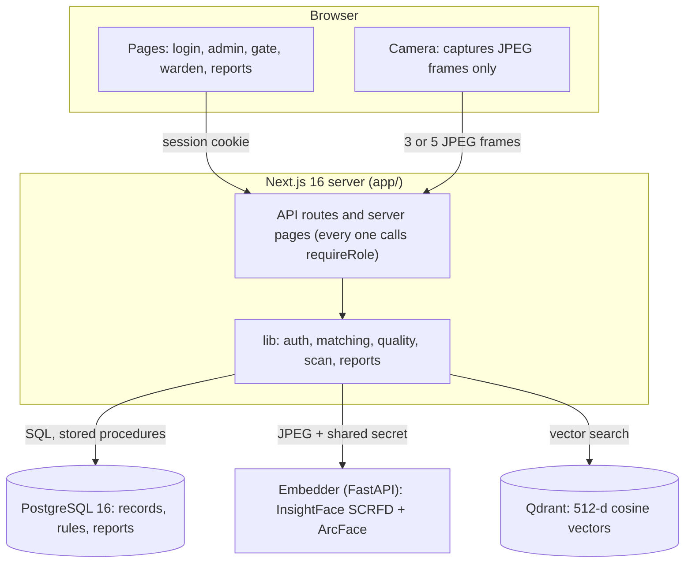
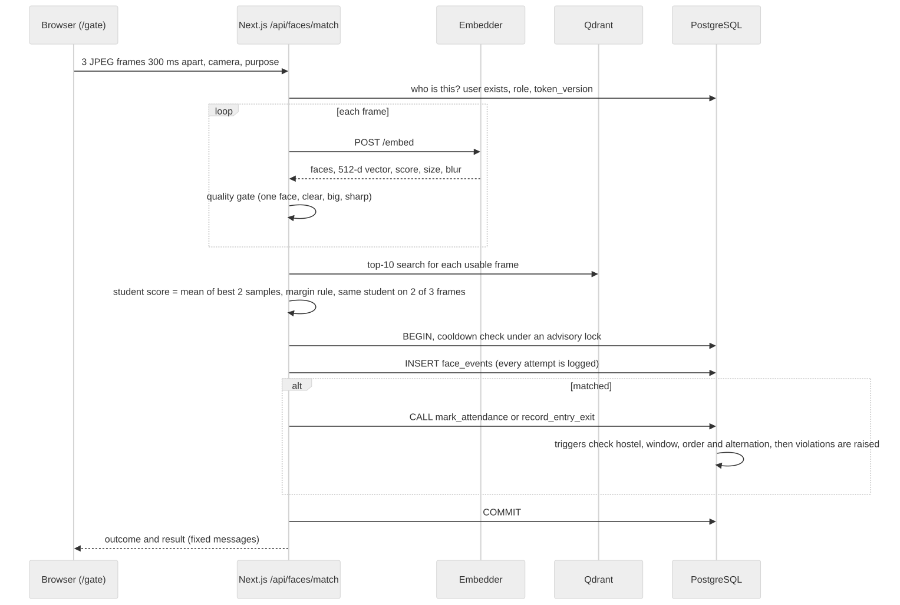
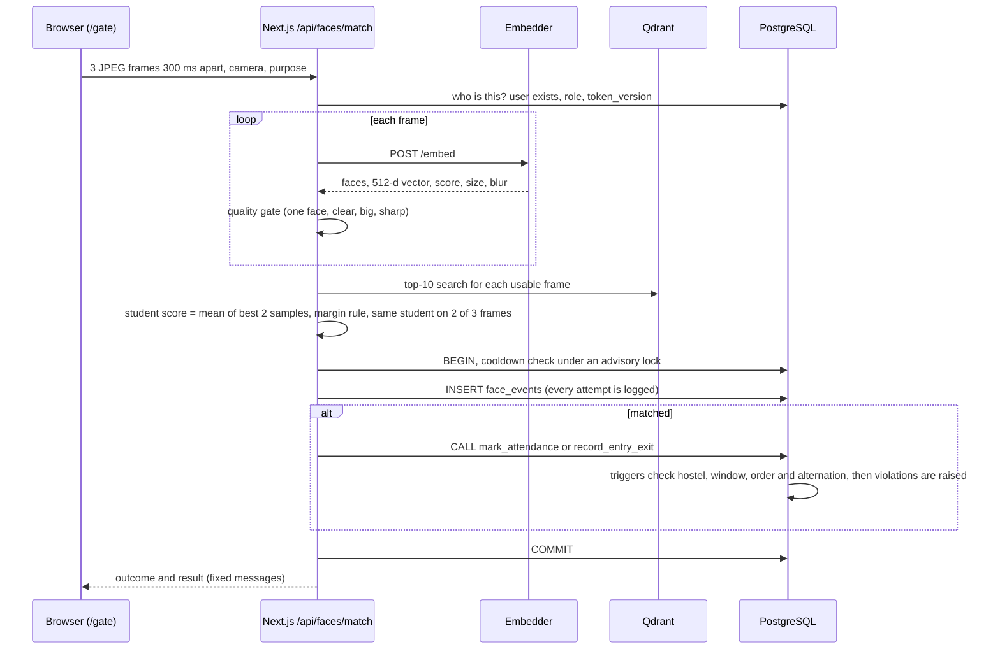

# Architecture

FaceTrackDB is a hostel attendance system: a student's face at the gate or at roll call is recognised, and every record, rule and report lives in PostgreSQL. Faces are compared as vectors in Qdrant.

## Components

| Part | What it does | Where |
|---|---|---|
| Browser | Shows pages, captures camera frames (no face analysis in the browser) | `app/app/*`, `app/components/` |
| Next.js server | Login, roles, API routes, pages, the matching rules, report pages | `app/` |
| PostgreSQL | Students, parents, hostels, sessions, attendance, gate log, leave, violations, login attempts, face profile links; constraints, triggers, procedures, views and the report functions | `db/*.sql` |
| Embedder | The only place an image is analysed: detects the face, returns a 512-number embedding and quality numbers. Bound to `127.0.0.1`, needs a shared secret | `embedder/` |
| Qdrant | Stores the embeddings and answers "which stored faces are closest to this one". Bound to `127.0.0.1`, needs an API key | `docker-compose.yml` |

PostgreSQL is the source of truth for **who** and **what happened**; Qdrant only knows vectors, linked to PostgreSQL by `face_profiles.qdrant_point_id` and the `student_id` in each point's payload. The Python service only produces embeddings, so all records, rules and reports stay in PostgreSQL.

## What happens at a gate scan

1. The browser sends only images. It never sees an embedding.
2. `requireRole` runs first. It checks the signed cookie, then that the user still exists, still has the role, and that the token's version is current, so a deleted or signed-out user is refused immediately.
3. Frames that fail the quality gate are dropped (fewer than 2 usable frames: nothing is logged and the guard is told why).
4. A student is accepted only if the same student wins confidently on at least 2 frames; otherwise the scan goes to the warden's review queue or is a no-match.
5. The face event and the attendance or gate record are written in **one transaction**. The database triggers refuse impossible records (wrong hostel, out-of-window mark, two OUTs in a row) and the procedures raise the violations (late return, left without leave, missed roll call).

## Security notes

- Every route and page checks the role through `requireRole` (`app/lib/auth.ts`). Error responses use fixed messages (`app/lib/db-errors.ts`); database text never reaches the browser.
- Sessions are 8-hour signed cookies (HttpOnly, SameSite=Lax) that can be revoked: a password change or the admin action "Sign out everywhere" adds 1 to `users.token_version`.
- Login is rate-limited in the database (`login_attempts`): 5 failures per email or 20 per address in 15 minutes.
- `JWT_SECRET` must be a random value of at least 32 characters; placeholders are refused and login fails closed.
- No raw photos are stored. See [privacy-and-biometric-policy.md](privacy-and-biometric-policy.md) and [vector-design.md](vector-design.md).

The diagrams are Mermaid, so they render on GitHub from the code blocks; the `.svg` files next to this page are the same diagrams rendered to images.
