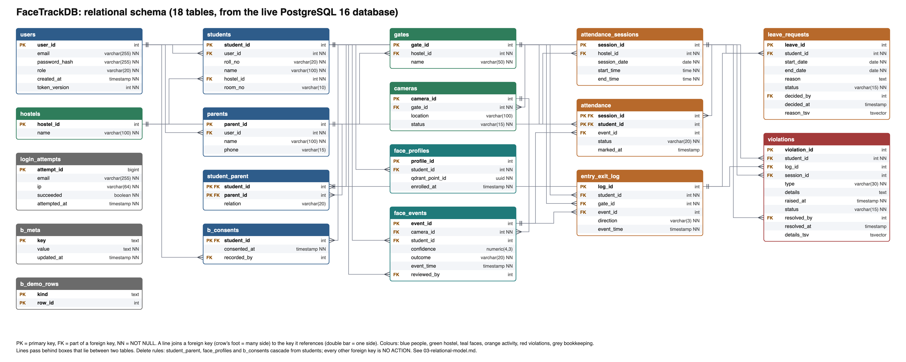

# ER model

Derived from `db/schema.sql`, `db/migrations/*.sql` and the `db/b_*.sql` files, and checked against a database loaded with `./db/load_all.sh`.

The picture is generated from the live schema (18 tables, 26 foreign keys): `db/docs/er-diagram.png` / `.svg`, with the same schema as `db/docs/er-diagram.dbml` (paste into dbdiagram.io). A line runs from a foreign key (crow's foot = many) to the key it references (double bar = one).

Cardinalities use (min,max) read from the side of the entity named first. A "total" participation means the foreign key is `NOT NULL`; "partial" means it is nullable or nothing forces a row to exist. Only what the schema actually enforces is called enforced; rules that live in a function or in the app are marked.

## 1. Entities and primary keys

| # | Entity (table) | Primary key | Candidate / alternate keys | Notes |
|---|---|---|---|---|
| 1 | Hostel (`hostels`) | `hostel_id` (serial) | `name` UNIQUE | strong |
| 2 | User account (`users`) | `user_id` | `email` UNIQUE | role CHECK in (student, parent, warden, security, admin) |
| 3 | Student (`students`) | `student_id` | `roll_no` (SRN) UNIQUE, `user_id` UNIQUE | strong |
| 4 | Parent (`parents`) | `parent_id` | `user_id` UNIQUE | strong |
| 5 | Gate (`gates`) | `gate_id` | (`hostel_id`,`name`) UNIQUE | strong (own surrogate key) |
| 6 | Camera (`cameras`) | `camera_id` | none | strong |
| 7 | Face profile (`face_profiles`) | `profile_id` | `qdrant_point_id` UNIQUE | one row per enrolled image (5 per enrolment); links to a Qdrant vector |
| 8 | Face event (`face_events`) | `event_id` | (`event_id`,`student_id`) UNIQUE | one row per recognition attempt, any outcome |
| 9 | Roll call (`attendance_sessions`) | `session_id` | (`hostel_id`,`session_date`,`start_time`) UNIQUE | strong |
| 10 | Gate log entry (`entry_exit_log`) | `log_id` | (`log_id`,`student_id`) UNIQUE | one row per IN/OUT crossing |
| 11 | Leave request (`leave_requests`) | `leave_id` | none | exclusion constraint forbids overlapping approved leave per student |
| 12 | Violation (`violations`) | `violation_id` | partial unique indexes (`log_id`,`type`) and (`student_id`,`session_id`,`type`) | |
| 13 | Consent record (`b_consents`) | `student_id` (also an FK) | none | see weak-entity discussion |

Association (relationship) tables, **not** entities: `student_parent` (Student M:N Parent, attribute `relation`) and `attendance` (Student M:N Roll call, attributes `status`, `marked_at`, optional `event_id`). Bookkeeping tables that are not part of the ER model: `login_attempts`, `b_meta`, `b_demo_rows` (see section 5).

## 2. Weak entities

**There is no weak entity in the strict textbook sense** (an entity with only a partial key, identified through its owner's key): every entity has its own surrogate primary key.

Existence-dependent entities that come closest (stated so the report does not over-claim):

| Entity | Depends on | Why it looks weak | Why it is still not weak here |
|---|---|---|---|
| Face profile | Student | `ON DELETE CASCADE` on `student_id`; meaningless without the student | has its own key `profile_id`; owner key is not part of its PK |
| Consent record (`b_consents`) | Student | PK **is** the owner's key `student_id` and it cascades: identification by the owner, total participation | 1:1 and no partial key of its own, so it is better described as an existence-dependent (identifying) 1:1 extension of Student than a weak entity with a discriminator |
| Camera | Gate | camera cannot exist without a gate (`NOT NULL`) | own surrogate key; no cascade (delete is restricted) |
| Roll call | Hostel | identified in practice by (hostel, date, start_time) | that natural key is only a UNIQUE constraint; PK is `session_id` |

The two association tables `student_parent` (PK = both parent keys) and `attendance` (PK = `session_id`,`student_id`) take their identity entirely from the entities they connect; they are the textbook **associative entities** (relationship with attributes), not weak entities.

## 3. Non-simple attributes

* **Composite attributes: none stored as composite columns.** Two strings carry structure but are not decomposed in the schema: the SRN `roll_no` (for example `22CS104` = admission year, department code, serial; the department exists only inside this string, there is no department column) and `room_no` (for example `A-201`, hostel letter and room number). A time window is held as two simple columns `start_time`, `end_time`.
* **Multivalued attributes: none as a column.** The two multivalued facts are modelled as separate tables, the standard way: a student's several parents (`student_parent`, M:N; 1 or 2 enforced only by the function `register_student`, not by a constraint) and a student's several enrolment images (`face_profiles`, 5 rows per enrolment; the count 5 is enforced by the app, not by the schema).
* **Derived attributes** (computed, not stored as independent facts):
  * where a student is now (`presence` = latest gate direction): view `v_current_presence` (`db/b_queries.sql` lines 16-39);
  * attendance percentage: view `v_attendance_summary` (lines 42-56) and report functions;
  * time outside per trip: view `v_report_trips` (`db/b_reports.sql` line 30);
  * `violations.details_tsv` and `leave_requests.reason_tsv`: **derived and stored** (`GENERATED ALWAYS AS (to_tsvector('english', ...)) STORED`, `db/b_search.sql` lines 10-20), the only derived attributes materialised as columns; they exist for full-text search and are not part of the conceptual model;
  * a violation's status is not derived: `status` is stored and kept consistent with `resolved_by` and `resolved_at` by CHECK constraints.

## 4. Relationships, cardinality and participation

"Enforced by" names the mechanism in the schema.

| # | Relationship | Entities | Cardinality | Participation | Enforced by |
|---|---|---|---|---|---|
| R1 | has login | User - Student | 1 : 0..1 (a user is at most one student) | Student total (`user_id NOT NULL UNIQUE`); User partial | FK `students_user_id_fkey`, UNIQUE |
| R2 | has login | User - Parent | 1 : 0..1 | Parent total; User partial | FK `parents_user_id_fkey`, UNIQUE |
| R3 | role must match | User -> Student / Parent / reviewer / resolver | n/a | n/a | triggers `trg_students_role`, `trg_parents_role`, `trg_face_events_reviewer_role`, `trg_violations_resolver_role` (function `fn_check_user_role`) |
| R4 | lives in | Hostel - Student | 1 : N | Student total (`hostel_id NOT NULL`); Hostel partial | FK `students_hostel_id_fkey` |
| R5 | has | Hostel - Gate | 1 : N | Gate total; Hostel partial | FK `gates_hostel_id_fkey`, UNIQUE (hostel, name) |
| R6 | has | Gate - Camera | 1 : N | Camera total; Gate partial | FK `cameras_gate_id_fkey` |
| R7 | is parent of | Student - Parent | **M : N** (attribute `relation`: father, mother, guardian) | both partial in the schema (a student having 1-2 parents is only checked by `register_student`) | table `student_parent`, composite PK, both FKs `ON DELETE CASCADE` |
| R8 | enrolled as | Student - Face profile | 1 : N (5 per enrolment) | Face profile total; Student partial | FK `face_profiles_student_id_fkey` `ON DELETE CASCADE` |
| R9 | has vector | Face profile - Qdrant point | 1 : 1 | total on the PostgreSQL side | `qdrant_point_id UUID NOT NULL UNIQUE` (the point itself is outside PostgreSQL, so referential integrity here is kept by app code in `app/lib/faces.ts`) |
| R10 | captured by | Camera - Face event | 1 : N | Face event total (`camera_id NOT NULL`); Camera partial | FK `face_events_camera_id_fkey` |
| R11 | recognised as | Student - Face event | 1 : N | **Face event partial** (`student_id` NULL for `no_match`); Student partial | FK + CHECK `face_events_student_matches_outcome` (`no_match` iff `student_id IS NULL`) |
| R12 | reviewed by | User (warden/admin) - Face event | 1 : N | partial both | FK `face_events_reviewed_by_fkey` + role trigger |
| R13 | roll call of | Hostel - Roll call | 1 : N | Roll call total; Hostel partial | FK, UNIQUE (hostel, date, start_time), CHECK `end_time > start_time` |
| R14 | marked in (associative entity `attendance`) | Student - Roll call | **M : N** (attributes `status`, `marked_at`, `event_id`) | both partial; one row per student per roll call (PK) | PK (`session_id`,`student_id`), trigger `trg_attendance_validate` (student must live in the roll call's hostel, time inside window, a `present` mark cannot be downgraded) |
| R15 | evidenced by | Attendance - Face event | N : 0..1 | partial (manual marks and absences have no event) | composite FK `attendance_event_fk` (`event_id`,`student_id`) -> `face_events(event_id,student_id)`: the event must be the same student's |
| R16 | crossing | Student - Gate log entry | 1 : N | Log total; Student partial | FK `entry_exit_log_student_id_fkey`; trigger `trg_entry_exit_validate` (gate belongs to student's hostel, time order, IN/OUT alternate) |
| R17 | at | Gate - Gate log entry | 1 : N | Log total | FK `entry_exit_log_gate_id_fkey` |
| R18 | evidenced by | Gate log entry - Face event | N : 0..1 | partial (manual security entries have no event) | composite FK `log_event_fk` |
| R19 | requests | Student - Leave request | 1 : N | Leave total; Student partial | FK `leave_requests_student_id_fkey` |
| R20 | decided by | Parent - Leave request | 1 : N | partial (NULL while pending) | composite FK `leave_decider_is_parent` (`student_id`,`decided_by`) -> `student_parent(student_id,parent_id)`: only a parent linked to **that** student can decide; CHECK `leave_decision_consistent`; procedure `decide_leave` |
| R21 | approved leave must not overlap | Leave request - Leave request (same student) | n/a | n/a | exclusion constraint `leave_no_overlap` (GiST, needs `btree_gist`) |
| R22 | committed by | Student - Violation | 1 : N | Violation total | FK `violations_student_id_fkey` |
| R23 | caused by | Violation - Gate log entry | N : 0..1 | partial | composite FK `violations_log_fk` (`log_id`,`student_id`) |
| R24 | caused by | Violation - Roll call | N : 0..1 | partial | FK `violations_session_id_fkey`; CHECK `violations_has_source` (log or session must be present) |
| R25 | resolved by | User (warden/admin) - Violation | 1 : N | partial (NULL while open) | FK, CHECKs `violations_resolution`, `violations_resolved_at_consistent`, role trigger |
| R26 | consented | Student - Consent record | 1 : 1 | Consent partial in the schema (a function inserts it with the student) | PK = FK `student_id`, `ON DELETE CASCADE` |
| R27 | recorded by | User (admin) - Consent record | 1 : N | partial | FK `b_consents_recorded_by_fkey` |

No ternary relationships and no recursive (unary) relationships exist. The only "self" rule is R21 (two rows of the same entity may not overlap), implemented as a constraint and not as a relationship.

## 5. Relations that are not entities in the ER model

| Relation | Why it is not an ER entity |
|---|---|
| `student_parent` | junction table of the M:N relationship Student-Parent (carries the attribute `relation`) |
| `attendance` | junction table of the M:N relationship Student-Roll call, with attributes (associative entity) |
| `login_attempts` | operational log for login rate limiting; deliberately has no foreign keys (it must also record attempts for emails that do not exist) |
| `b_meta` | key/value bookkeeping (for example the label "this database contains generated demo history") |
| `b_demo_rows` | tracking table of the demo seed: ids of generated rows, so `demo_reset()` removes exactly those |
| `b_consents` | an existence-dependent 1:1 extension of Student (consent record), see section 2 |

Views (`v_current_presence`, `v_attendance_summary`, `v_open_violations`, `v_review_queue`, `v_report_trips`) are derived relations, not stored.

## 6. Foreign keys and delete rules

26 foreign keys. Four cascade from their owner: `student_parent` (both sides), `face_profiles.student_id` and `b_consents.student_id`. The other 22 are NO ACTION (the delete is refused while rows still refer to the row), so history (attendance, gate log, scans, leave, violations) is never deleted silently; `delete_student` refuses with error FT055 when a student has history. No foreign key has an ON UPDATE rule. Four are composite and prove ownership: `attendance_event_fk`, `log_event_fk` (the face event must belong to the same student), `violations_log_fk`, `leave_decider_is_parent` (only a parent linked to that student can decide the leave).
